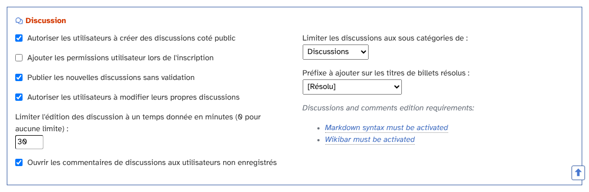
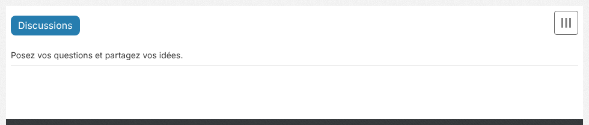
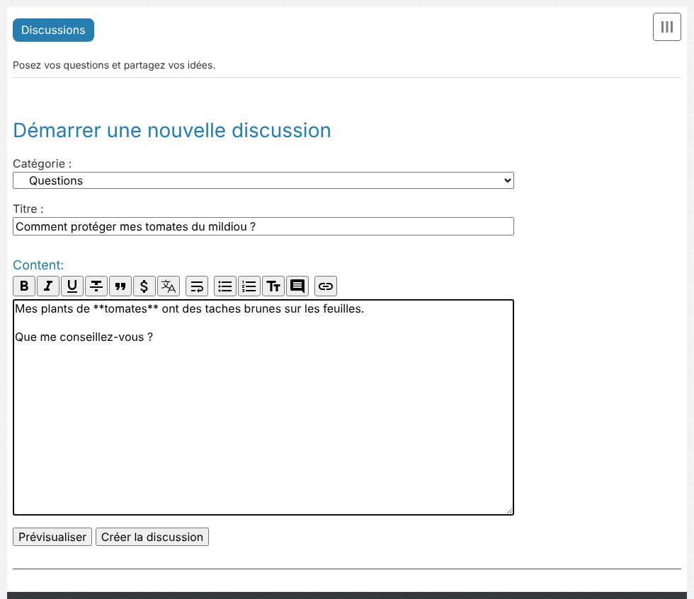
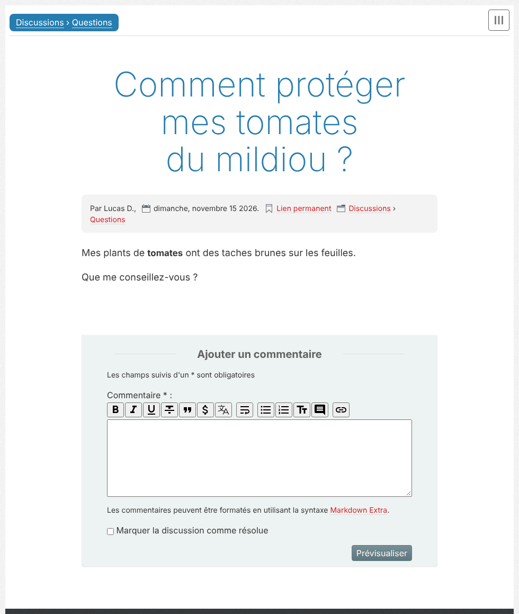
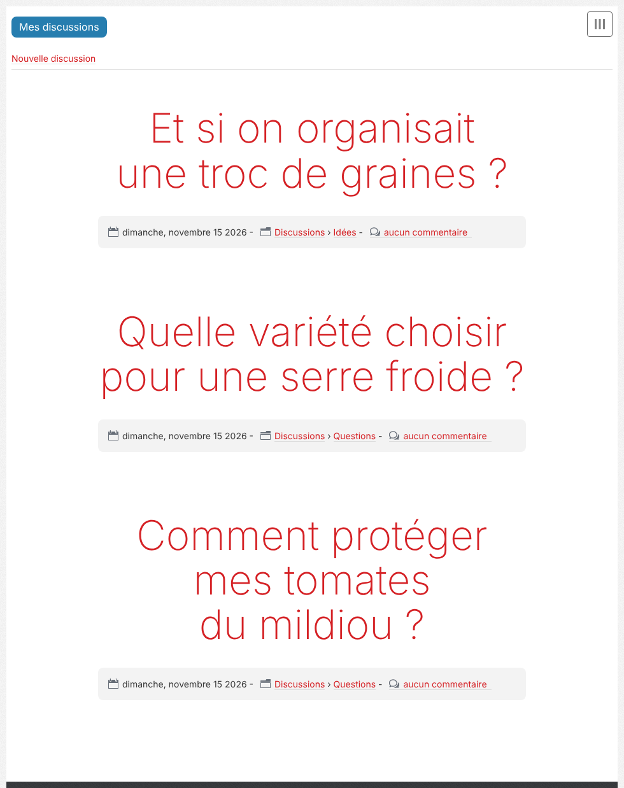
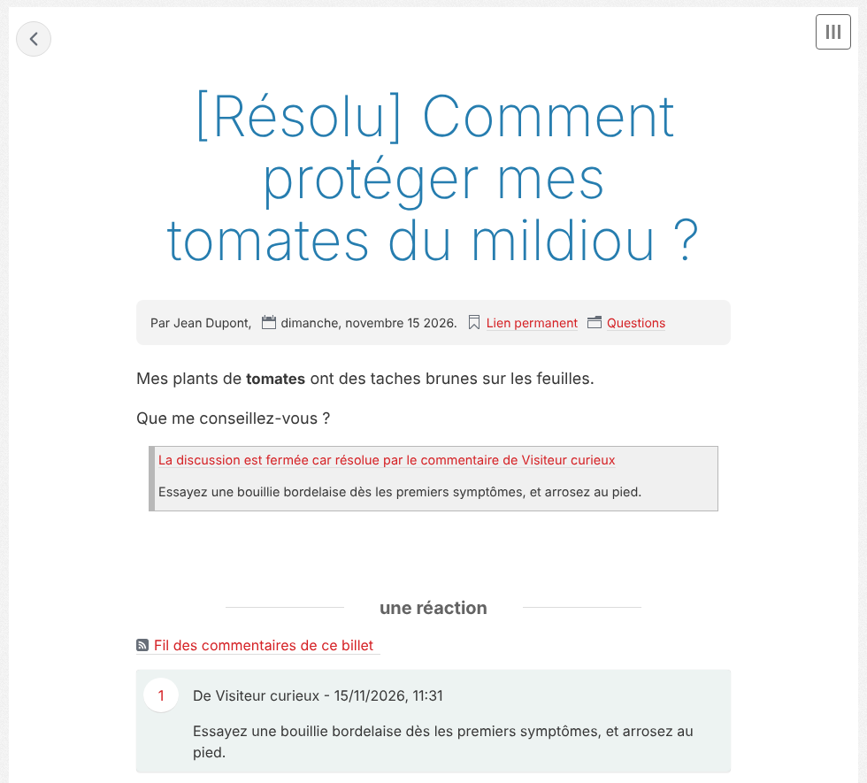
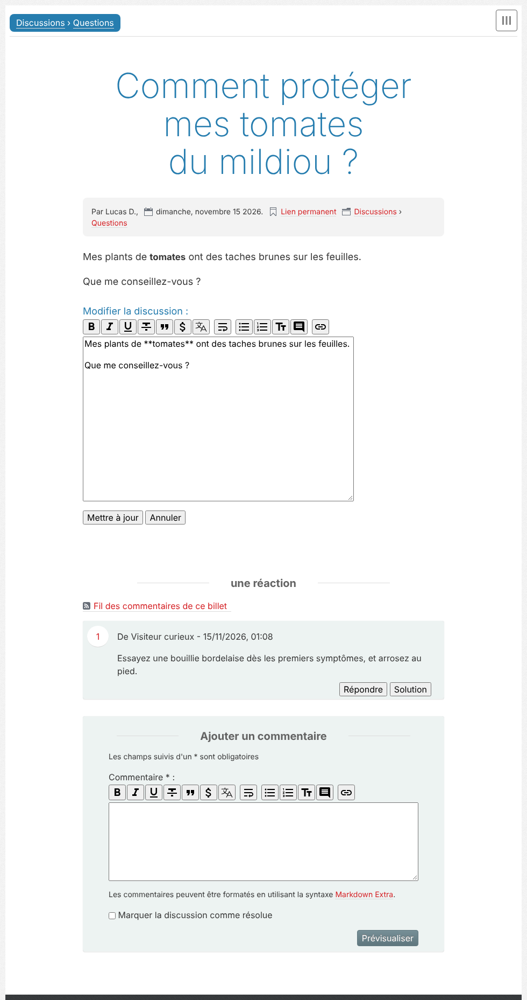
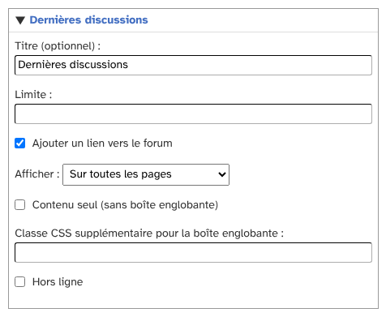
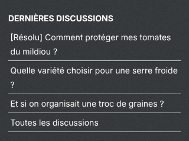

# Discussion : guide d'utilisation

Discussion permet aux visiteurs connectés de poster des discussions depuis le site public du blog, comme sur un petit forum. Les discussions sont de simples billets rangés dans une catégorie du blog. Les autres visiteurs y répondent par des commentaires, et la réponse qui règle le problème peut être marquée comme solution.

Ce plugin n'a pas de page d'administration : tout se règle dans les paramètres du blog.

## Sommaire

1. [Ce qu'il faut avant de commencer](#ce-quil-faut-avant-de-commencer)
2. [Régler le plugin](#régler-le-plugin)
3. [Préparer les catégories](#préparer-les-catégories)
4. [Donner le droit de poster](#donner-le-droit-de-poster)
5. [Les pages publiques](#les-pages-publiques)
6. [Créer une discussion](#créer-une-discussion)
7. [Répondre et résoudre](#répondre-et-résoudre)
8. [Modifier ses messages](#modifier-ses-messages)
9. [Le widget « Dernières discussions »](#le-widget--dernières-discussions)
10. [Les flux](#les-flux)
11. [Bon à savoir](#bon-à-savoir)

## Ce qu'il faut avant de commencer

Discussion s'appuie sur d'autres plugins :

* **FrontendSession** (obligatoire) : il gère la connexion des visiteurs sur le site public. Activez-le d'abord.
* **commentsWikibar** et **Markdown syntax** (facultatifs) : ils ajoutent la barre d'outils et le Markdown dans les formulaires. Sans eux, la modification des messages n'est pas possible.

Le plugin fonctionne avec tous les thèmes : ses pages utilisent toujours ses propres gabarits et sa feuille de style.

## Régler le plugin

Allez dans **Blog > Paramètres du blog**, puis ouvrez la section **Paramètres des plugins pour ce blog**. Le bloc **Discussion** contient :

* **Activer la publication de discussions sur le site** : interrupteur général. Tant qu'il est décoché, les pages du plugin n'existent pas.
* **Ajouter les permissions utilisateur lors de l'inscription** : un visiteur qui s'inscrit reçoit tout de suite le droit de poster.
* **Publier les nouvelles discussions sans validation** : sinon les discussions arrivent « en attente » et vous devez les valider.
* **Autoriser les utilisateurs à modifier leurs propres discussions** : voir [Modifier ses messages](#modifier-ses-messages).
* **Limiter l'édition des discussions à un temps donné en minutes** : 0 pour ne pas limiter.
* **Ouvrir les commentaires de discussions aux utilisateurs non enregistrés** : les visiteurs sans compte peuvent répondre.
* **Limiter les discussions aux sous-catégories de** : choisit la catégorie « racine » du forum.
* **Préfixe à ajouter sur les titres de billets résolus** : par exemple `[Résolu]` ou `✓`.

La modification des messages n'est proposée que si commentsWikibar est actif **et** si la syntaxe Markdown est activée pour les commentaires. Une note sous les réglages le rappelle.

## Préparer les catégories

Créez une catégorie qui servira de forum, par exemple **Discussions**, et des sous-catégories dedans, par exemple **Questions** et **Idées**. Dans les réglages, choisissez **Discussions** dans « Limiter les discussions aux sous-catégories de ».

Les visiteurs choisissent une sous-catégorie pour chaque discussion. La catégorie racine elle-même ne peut pas être choisie.

Si vous ne choisissez aucune catégorie racine, toutes les catégories du blog sont proposées.

## Donner le droit de poster

Un visiteur doit être connecté **et** avoir la permission **Discussion**. Deux solutions :

* cochez **Ajouter les permissions utilisateur lors de l'inscription** pour les nouveaux inscrits ;
* ou donnez la permission à la main, dans la fiche de l'utilisateur, avec le bouton des permissions du blog.

L'utilisateur doit aussi avoir la permission de FrontendSession pour se connecter.

Un visiteur sans la permission ou non connecté obtient une page « Document non trouvé » sur les pages de création.

## Les pages publiques

Toutes les adresses commencent par `discussion` après l'adresse du blog.

| Adresse | Contenu |
|---|---|
| `/discussion` | La liste des catégories de discussions |
| `/discussion/create` | Le formulaire pour démarrer une discussion |
| `/discussion/posts` | Mes discussions |
| `/discussion/feed/atom` et `/discussion/feed/rss2` | Les flux |

Le menu de la session (FrontendSession) propose aussi les liens **Nouvelle discussion** et **Mes discussions** une fois connecté.

## Créer une discussion

1. Connectez-vous sur le site.
2. Ouvrez **Nouvelle discussion**.
3. Choisissez une **catégorie**, écrivez un **titre** et le texte de la discussion. La syntaxe Markdown est utilisée.
4. Cliquez sur **Prévisualiser** pour vérifier, puis sur **Envoyer**.

La discussion s'affiche aussitôt. Si vous avez décoché « Publier sans validation », elle reste en attente jusqu'à sa validation par un administrateur.

La page **Mes discussions** liste toutes vos discussions, avec le préfixe de résolution pour celles qui sont réglées.

## Répondre et résoudre

Chaque visiteur répond par un commentaire. Le bouton **Répondre** de chaque commentaire permet de répondre à un message précis.

L'auteur de la discussion, et les administrateurs de contenu, ont deux moyens de la résoudre :

* le bouton **Solution** sous un commentaire : ce commentaire devient la réponse ;
* ou la case **Marquer la discussion comme résolue** en écrivant un nouveau commentaire.

Une discussion résolue :

* reçoit le préfixe choisi dans son titre (par exemple `[Résolu]`) ;
* est fermée : le formulaire de commentaire disparaît ;
* affiche un encadré « La discussion est fermée car résolue par le commentaire de … » avec le texte de la solution.

Le site public ne propose pas de bouton pour rouvrir une discussion.

## Modifier ses messages

Si la modification est autorisée, l'auteur voit un bouton **Modifier** sous sa discussion, et sous ses propres commentaires. Les administrateurs de contenu peuvent modifier tous les messages.

Le texte s'ouvre dans la barre d'outils. Cliquez sur **Mettre à jour** pour enregistrer ou **Annuler**.

La modification est possible :

* seulement pendant le délai réglé, compté depuis la création du message ;
* seulement tant que la discussion n'est pas résolue.

## Le widget « Dernières discussions »

Dans **Système > Widgets**, ajoutez le widget **Dernières discussions** dans la zone de votre choix.

Les discussions résolues y portent le préfixe choisi, comme sur les titres des billets.

Ses réglages : le titre, le nombre de discussions affichées (**Limite**) et l'option **Ajouter un lien vers le forum**, qui ajoute en bas le lien « Toutes les discussions ». Comme les autres widgets, il se règle aussi pour n'apparaître que sur l'accueil, et pour sa classe CSS.

## Les flux

`/discussion/feed/atom` et `/discussion/feed/rss2` donnent les dernières discussions et les derniers commentaires des discussions. Ils ne fonctionnent que si le plugin est activé.

## Bon à savoir

* **Commentaires non enregistrés** : si vous les autorisez, tout visiteur peut répondre, mais seuls l'auteur de la discussion et les administrateurs peuvent la marquer comme résolue.
* **Flux** : la balise auteur du flux Atom reste vide.
